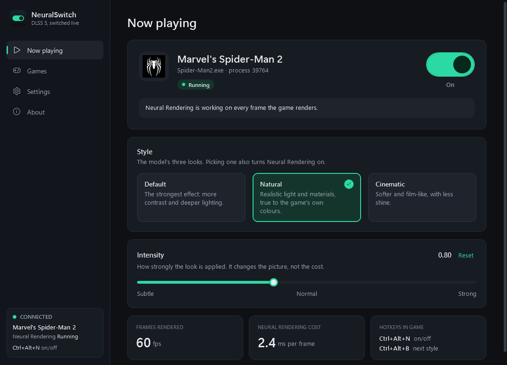

# NeuralSwitch

[](https://github.com/Razni-Ahamed/NeuralSwitch/actions/workflows/build.yml)
[](LICENSE)

**Turn DLSS 5 Neural Rendering on and off, and switch between its Default, Natural and Cinematic
looks, while you play.** It works in games that already support DLSS but have no DLSS 5 of their own.

> [!CAUTION]
> **Unofficial and experimental. Use at your own risk.** NeuralSwitch loads a third-party mod into
> your games through an undocumented NVIDIA driver feature. **Never use it in online or multiplayer
> games**: anti-cheat can ban your account. The authors accept no responsibility for any consequences.
> Read **[USER_CAUTION.md](USER_CAUTION.md)** before using it.



---

## Contents

- [What is this?](#what-is-this)
- [Features](#features)
- [What you need](#what-you-need)
- [Quick start](#quick-start)
- [How it works](#how-it-works)
- [Safety by design](#safety-by-design)
- [Project status](#project-status)
- [Building from source](#building-from-source)
- [Documentation](#documentation)
- [Credits](#credits)
- [License](#license)

## What is this?

**DLSS 5 Neural Rendering** is NVIDIA's AI pass over a game's finished frame. Using the game's own
colour, depth and motion data, it adds more realistic lighting, materials, skin and hair. It comes in
three styles:

| Style | Look |
|---|---|
| **Default** | The strongest effect: more local contrast and deeper lighting. Can look stylised. |
| **Natural** | The same detail work with a gentler hand. Colours and skin tones stay close to what the game drew. |
| **Cinematic** | Less shine and over-processing, for a film-like look. |

Officially, a game only gets DLSS 5 when its developers build it in. Community projects found a way
to run the model in **any game that already uses DLSS upscaling**: the frames DLSS produces already
carry everything the model needs. The most complete of these is
[OptiScaler-DLSS5](https://github.com/Skynizz/optiscaler-dlss5). It works, but you control it from a
menu inside the game.

**NeuralSwitch adds the missing piece: control from outside the game.** It's an app that prepares
your games with one click and then switches Neural Rendering live, from its window or with global
hotkeys. You never have to leave the game or open its menu.

## Features

- **Live switching.** On/off, Default/Natural/Cinematic and intensity (0–2) change while the game runs,
  with no restart.
- **Hotkeys that work in game.** **Ctrl+Alt+N** turns it on or off and **Ctrl+Alt+B** moves to the next
  style, while the game keeps focus. You can change both in Settings.
- **Stays out of the way.** Closing the window keeps NeuralSwitch in the notification area, with its
  hotkeys and a menu to switch Neural Rendering and styles. Starting it twice brings back the one
  already running.
- **Finds your games.** It scans your library folders for games that ship DLSS and picks each game's
  real executable (it handles Unreal Engine layouts, Streamline folders and installer leftovers).
- **One-click prepare and remove.** Every file it adds is recorded, so **Remove** puts the folder back
  exactly as it was.
- **Live status.** Whether the model is running, frames per second, the model's cost per frame, and
  the exact reason when it can't start, with a **Try again** button.
- **A command-line tool** (`neuralswitch-cli`) for scripts and stream decks.
- **An open protocol.** Any program can control the engine; see [docs/PROTOCOL.md](docs/PROTOCOL.md).

## What you need

| Requirement | Details |
|---|---|
| **Windows 10 or 11, 64-bit** | |
| **NVIDIA RTX GPU** | NVIDIA's model runs natively on **RTX 50 series** cards. Older RTX cards are not supported. |
| **NVIDIA driver 616.56 or newer** | |
| **NVIDIA's model, `nvngx_dlssnr.dll`** | **Not included, never downloaded.** It comes with games that ship DLSS 5, and NVIDIA's driver downloads it the first time one of them runs (driver 621.01 does not include it). NeuralSwitch finds it, or you point it at a copy, and it checks the copy is **signed by NVIDIA**. |
| **A single-player game that supports DLSS** | With DLSS **turned on** in the game's graphics settings. Games with known anti-cheat are refused. |

## Quick start

1. **Download** the latest zip from [Releases](https://github.com/Razni-Ahamed/NeuralSwitch/releases)
   and unzip it to a folder of your own, for example `C:\Tools\NeuralSwitch`. Keep the `engine` folder
   beside `NeuralSwitch.exe`.
2. **Run `NeuralSwitch.exe`** and read **Before you start**. Accept it to continue. Your DLSS games
   appear on the **Games** page. Use **Add folder** if your games aren't in `C:\Games`.
3. **Make sure NVIDIA's model is found.** The Games page shows a yellow banner if it isn't, and
   **Settings** has **Locate model…**.
4. **Click Prepare** on a game. Nothing visible changes yet: the game starts with Neural Rendering off.
5. **Start the game and turn DLSS on** in its graphics settings. The game appears under **Now
   playing**. Flip the switch, or press **Ctrl+Alt+N**.

The **[User Guide](docs/USER_GUIDE.md)** walks through every step, every message the app can show,
and troubleshooting.

## How it works

NeuralSwitch has three parts: the app, the engine inside the game, and NVIDIA's model.

```
                     ┌──────────────────────────────── your game's process ─────────────────────────┐
                     │                                                                              │
 ┌──────────────┐    │   game renders ──► game's DLSS upscaling ──► engine: DLSS 5 Neural Rendering │
 │ NeuralSwitch │    │   a frame          (nvngx_dlss.dll)          (OptiScaler-DLSS5, as winmm.dll) │
 │  app / CLI   │    │                                                   │          │               │
 └──────┬───────┘    │                                                   │          ▼               │
        │            │                                                   │   NVIDIA's model         │
        │  "set enabled=true style=natural"                              │   (nvngx_dlssnr.dll)     │
        └────────────┼─► \\.\pipe\neuralswitch-<pid> ──► queued ──► applied on the next frame        │
                     │                                                   by the render thread       │
                     └──────────────────────────────────────────────────────────────────────────────┘
```

### 1. Preparing a game

When you click **Prepare**, the app copies four files beside the game's executable:

| File | What it is |
|---|---|
| `winmm.dll` (or `version.dll`, `dbghelp.dll`, `wininet.dll`, `winhttp.dll`, or `OptiScaler.asi` next to an ASI loader) | **The engine.** Windows loads DLLs from a game's own folder before system ones, so the game loads it on start. The app picks the first name the game isn't already using. |
| `nvngx.dll_dlssnr.dll` | A small forwarder the engine needs to reach NVIDIA's model. |
| `nvngx_dlssnr.dll` | **NVIDIA's model**, copied from where the app found it. |
| `OptiScaler.ini` | The engine's settings: Neural Rendering **off** at start, your chosen style, remote control on. |

It also writes `neuralswitch.installed.json`, a record of each file and its checksum. **Remove** uses
that record to delete exactly those files, plus the engine's log, and nothing else.

### 2. Inside the game

When the game starts, Windows loads the engine. The engine hooks the game's DLSS. Each time the game
asks DLSS to upscale a frame, the engine can run NVIDIA's model over the result before the game draws
its HUD. It is the [OptiScaler-DLSS5](https://github.com/Skynizz/optiscaler-dlss5) engine, unchanged
except for one addition.

### 3. The remote control (NeuralSwitch's patch)

NeuralSwitch's patch to the engine ([engine/patches](engine/patches)) adds a **named pipe**,
`\\.\pipe\neuralswitch-<process id>`. The engine opens it on the game's first frame.

- **The app finds running games** by listing the pipes. No process injection or memory scanning is
  involved.
- **A click becomes one line of text**, such as `set enabled=true style=natural`. The engine answers
  with one line of JSON describing its state.
- **The engine never changes settings from the pipe's thread.** It queues the request, and the game's
  **render thread** applies it on the next frame, the same place the engine's own in-game hotkey takes
  effect. A click in the app is therefore exactly as safe as a key press in the game. Changes land
  within a frame or two.
- **The pipe is local only.** It rejects remote connections, and with Windows' default pipe security
  only your user account can write to it.

The full protocol is in [docs/PROTOCOL.md](docs/PROTOCOL.md).

## Safety by design

| Risk | What NeuralSwitch does |
|---|---|
| Not knowing the risks | On first run, shows a summary of the [user caution](USER_CAUTION.md) that must be accepted before anything else works. |
| Account bans | Refuses to prepare games with known anti-cheat (EasyAntiCheat, BattlEye, EA AntiCheat and others). Read the limits in [USER_CAUTION.md](USER_CAUTION.md). |
| Tampered model files | Checks `nvngx_dlssnr.dll` with Windows' own Authenticode verification, and accepts it only when it's validly signed by NVIDIA Corporation. Otherwise it warns you before going on. |
| Breaking a game's folder | Never overwrites a file it didn't install. Refuses when another OptiScaler install is present. Rolls back a half-finished install. Records every file so **Remove** is exact. |
| Changing files in use | Refuses to prepare or remove while the game is running. |
| Crashes from remote commands | Commands are applied by the game's render thread, never by the pipe thread. |
| Other people's software | Never downloads NVIDIA's files. The engine is built from a pinned, public commit plus a small, readable patch. |

## Project status

**Early: version 0.1.** What has been verified:

- The full live-control path against the **real built engine**: a Direct3D 12 test program loads it
  the way a game does, and the CLI drives it (on/off, style, intensity, toggle, rejecting bad input).
  Run it yourself with `tools/engine-smoke-test`.
- Unit tests for the pipe protocol, game detection, installing and removing, and the signature check.
- **The app itself, end to end.** `tools/ui-check` drives the real window with Windows UI Automation
  against a simulated game and checks after every step that the game received the change. It covers
  the first-run caution, the switch, styles, intensity, the global hotkey, settings, preparing and
  removing a game, close-to-tray and single instance: 33 checks.
- Every page rendered in every state with no broken data bindings (`NeuralSwitch.exe --render-preview <folder>`).

**Not yet verified by the maintainer:** Neural Rendering running in an actual game through NeuralSwitch.
That needs NVIDIA's model file, which wasn't available on the development PC. Reports are welcome.

**Known limitations**

- Direct3D 12 games work best. DX11 and Vulkan games go through the engine's bridges.
- Only games that use DLSS upscaling are supported.
- The engine depends on an undocumented driver feature, so driver updates may break it.

## Building from source

```bash
git clone https://github.com/Razni-Ahamed/NeuralSwitch.git
cd NeuralSwitch
dotnet build NeuralSwitch.sln
dotnet test NeuralSwitch.sln
powershell -ExecutionPolicy Bypass -File engine\build-engine.ps1
powershell -ExecutionPolicy Bypass -File scripts\package.ps1
```

| You need | For |
|---|---|
| [.NET 8 SDK](https://dotnet.microsoft.com/download) | The app, the CLI and the tests |
| git, and Visual Studio 2022 or 2026 (the free Build Tools are enough) with **Desktop development with C++** | The engine; see [engine/README.md](engine/README.md) |

The release zip lands in `artifacts/`. GitHub Actions builds and tests every push. A `v*` tag also
builds the engine and publishes the zip as a release.

| Folder | Contents |
|---|---|
| `src/NeuralSwitch` | The app (WPF) |
| `src/NeuralSwitch.Core` | Game scanning, installing, finding and checking the model, the pipe client, a simulated game |
| `src/NeuralSwitch.Cli` | `neuralswitch-cli` |
| `tests/NeuralSwitch.Tests` | Unit tests |
| `engine/` | The pinned engine commit, the patch and the build script |
| `tools/engine-smoke-test` | Loads the real engine into a small Direct3D 12 program and drives it |
| `tools/ui-check` | Drives the real app window with UI Automation against a simulated game |
| `tools/make-icon.py` | Draws the app icon |
| `docs/` | The user guide, the protocol and the screenshot |

## Documentation

| Document | For |
|---|---|
| [User Guide](docs/USER_GUIDE.md) | Using the app, step by step, plus troubleshooting and the CLI |
| [User Caution](USER_CAUTION.md) | Risks, responsibilities, no warranty. **Read before use.** |
| [Protocol](docs/PROTOCOL.md) | Controlling the engine from your own program |
| [Engine](engine/README.md) | Building and changing the engine |
| [Notice](NOTICE.md) | Copyright, the engine's source, trademarks |
| [Third-party notices](THIRD_PARTY_NOTICES.md) | Every component and its license |

## Credits

- [OptiScaler](https://github.com/optiscaler/OptiScaler): cdozdil and the OptiScaler team.
- [OptiScaler-DLSS5](https://github.com/Skynizz/optiscaler-dlss5) by Skynizz, built on Dagherbou's
  OptiScaler_DLSSNR. It does the actual Neural Rendering.
- [RenoDX](https://github.com/clshortfuse/renodx) by clshortfuse, for the colour composition the engine
  uses.

NeuralSwitch isn't affiliated with NVIDIA or with any of the projects above. DLSS is a trademark of
NVIDIA Corporation.

## License

[GPL-3.0](LICENSE), the same as OptiScaler. See [NOTICE.md](NOTICE.md) for copyright and the engine's
corresponding source, and [THIRD_PARTY_NOTICES.md](THIRD_PARTY_NOTICES.md) for included components.
NeuralSwitch comes with **no warranty**; see [USER_CAUTION.md](USER_CAUTION.md).
